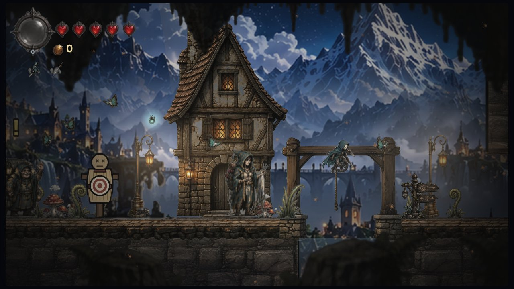
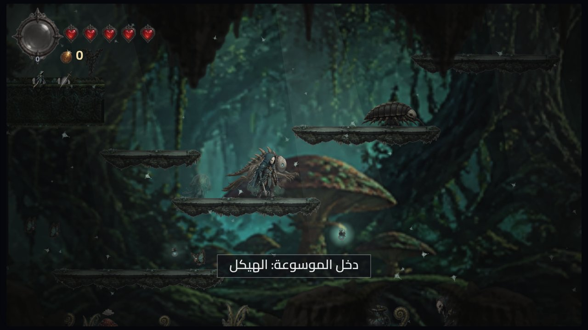
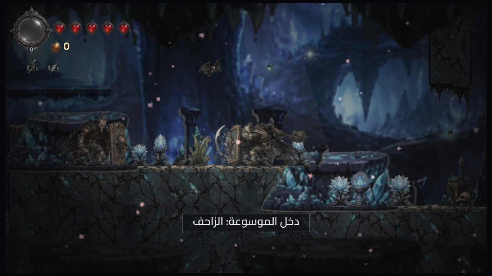
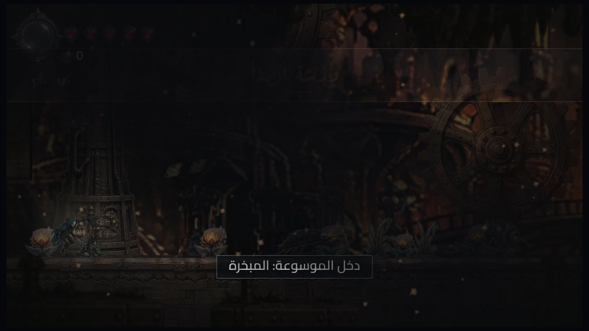

# Duskwell / أرض الغسق

لعبة استكشاف وقتال ثنائية الأبعاد من نوع Metroidvania، بالعربية والإنجليزية، تعمل في المتصفح وعلى أندرويد.

| | |
| --- | --- |
|  |  |
|  |  |

## التشغيل
- **في المتصفح:** https://khalilo-cs.github.io/Duskwell-/
- **على أندرويد:** آخر إصدار من صفحة الإصدارات https://github.com/khalilo-cs/Duskwell-/releases/latest
  (رابط مباشر: https://github.com/khalilo-cs/Duskwell-/releases/latest/download/duskwell.apk). يُثبَّت فوق الإصدارات السابقة ويبقى الحفظ.

## ما في اللعبة
- **عالم من 159 غرفة** في 15 منطقة، لكل منطقة رسوماتها وأرضياتها وموسيقاها وأصوات أجوائها، وتحت كل منطقة متاهة وكهف واسع وبرج.
- **البطل:** جري وقفز وقفزة مزدوجة واندفاع وتسلق الجدران، وأسلحة متعددة بضربات في كل اتجاه، وسحر وتمائم ومعدات.
- **37 نوعاً من الوحوش و17 زعيماً**، لكل منها حركاته وأصواته، والزعماء يتكلمون بالعربية.
- **حياة في كل غرفة:** نباتات تتمايل وحشرات وكائنات تهرب من البطل.
- **قوائم ومتجر وخريطة وموسوعة ومهام وحفظ**، وإعدادات للصورة والصوت وراحة العين.
- **الأداء على الجوال:** رسم مجزّأ للغرف الكبيرة، وحفظ القطع المرسومة جاهزة، وحركة ممزوجة بين الخطوات لسلاسة على شاشات 60 و90 و120 هرتز، وعدّاد أداء في قائمة الإيقاف.

## بنية المستودع
| المجلد | ما فيه |
| --- | --- |
| `duskwell/` | اللعبة: HTML5 Canvas وجافاسكربت بلا خطوة بناء (`js/` الكود، `art/` الرسومات، `audio/` الصوت، `tests/` 49 اختباراً آلياً، `tools/` أدوات تجهيز الرسومات والأصوات) |
| `duskwell-android/` | تطبيق أندرويد (WebView) وسكربت بناء الـ APK |
| `duskwell-unity/` | نسخة Unity مستقلة قيد العمل (C#)، بالغرف والبطل والوحوش والزعماء والمؤثرات |
| `game/`، `android/` | لعبة المنصّات Zaki Adventure ونسختها لأندرويد |
| `institute-webset2/` | موقع المعهد |

## الاختبارات
```
cd duskwell && node tests/<name>.test.js
```
تحتاج Node.js وPlaywright مع Chromium.
